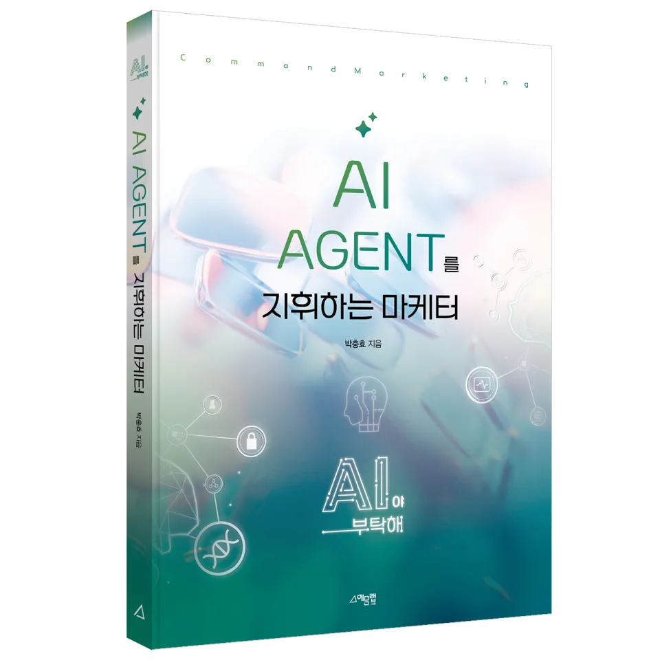
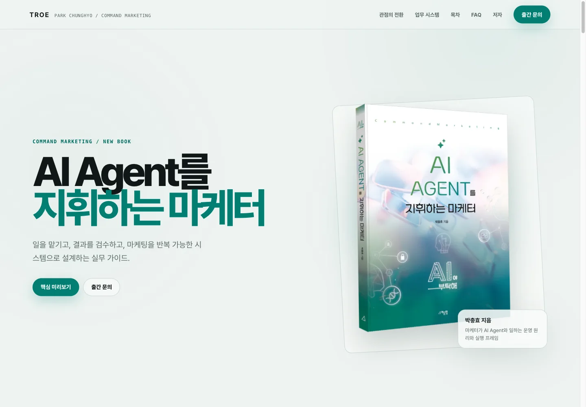
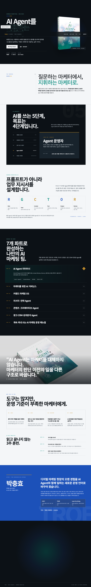

<p align="center">
  
</p>

<h1 align="center">AI Agent를 지휘하는 마케터</h1>

<p align="center">
  AI에게 일을 맡기고, 결과를 검수하고,<br>
  마케팅을 반복 가능한 시스템으로 설계하는 <strong>Command Marketing 도서 사이트</strong>
</p>

<p align="center">
  <a href="https://book.allrounder.im/"><strong>운영 사이트</strong></a>
  ·
  <a href="#로컬에서-실행하기">로컬 실행</a>
  ·
  <a href="mailto:chunghyo@troe.kr?subject=%EA%B0%95%EC%97%B0%C2%B7%EC%BB%A8%EC%84%A4%ED%8C%85%20%EB%AC%B8%EC%9D%98&amp;body=%EC%95%88%EB%85%95%ED%95%98%EC%84%B8%EC%9A%94.%0A%EA%B0%95%EC%97%B0%C2%B7%EC%BB%A8%EC%84%A4%ED%8C%85%20%EB%AC%B8%EC%9D%98%EB%93%9C%EB%A6%BD%EB%8B%88%EB%8B%A4.%0A%0A%EC%86%8C%EC%86%8D%2F%EC%9D%B4%EB%A6%84%3A%0A%EB%AC%B8%EC%9D%98%20%EB%82%B4%EC%9A%A9%3A%0A%ED%9D%AC%EB%A7%9D%20%EC%9D%BC%EC%A0%95%3A">강연·컨설팅 문의</a>
</p>

<p align="center">
  <code>TROE</code> · <code>박충효</code> · <code>Static HTML</code> · <code>Responsive</code> · <code>SEO/GEO</code>
</p>

---

## 한눈에 보기

<p align="center">
  <a href="https://book.allrounder.im/">
    
  </a>
</p>

이 저장소는 박충효 저 『AI Agent를 지휘하는 마케터』의 핵심 메시지를 웹에서 경험할 수 있도록 만든 반응형 프로모션 사이트입니다. 책 표지의 청록색 인상과 TROE의 절제된 브랜드 시스템을 비대칭 출판물 레이아웃으로 연결했습니다.

현재 사이트는 60초 상황 진단·도서 읽기 경로·공개 워크시트·문의 폼과 블로그14편(책 소개 시리즈3편+독서·실무 가이드11편)을 제공합니다. 새 독서 가이드는 책 속17개 업무별 Agent의 특징과 입력·산출물·검수 주제를 짧게 소개합니다. 새 기술 대응 가이드에서는2026년10월17일 확인된 Harness·Loop·Graph·Jev의 역할, 한국어 평가·권한·상태·승인·마케팅 응용을 다룹니다. 기존 도서와 편집 콘텐츠의 구분은 유지하고 PDF 파일 출처·페이지 대조 안내는 공개 블로그에서 제외했습니다.

> 최초 랜딩·블로그 5편은 PR #1로 main에 병합되었습니다(`9531877`). 책 소개·썸네일 확장도 PR #2로 main에 병합되었고(`1195354`), 2026-10-14 Vercel Production과 운영 도메인의 글 9편 공개 응답을 확인했습니다. 이번 검색 메타데이터 최적화는 `feat/blog-search-metadata`의 별도 후속 변경입니다. 코드 저장과 운영 배포 상태는 구분합니다.

## 사이트가 설명하는 것

| 주제 | 핵심 내용 |
|---|---|
| AI 활용 성숙도 | 도구 사용자에서 커맨드 마케터로 이동하는 5단계 |
| R-G-C-T-O-R | Role, Goal, Context, Tool, Output, Review로 업무 지시를 구조화하는 방법 |
| 도서 구성 | AI Agent 리터러시부터 리서치, 콘텐츠, 광고, CRM, 운영 매뉴얼까지 7개 파트 |
| 21일 훈련 | 업무 분해, 지시·검수 기준, 반복 운영을 연결하는 실천 플랜 |
| 사람과 Agent의 역할 | 사람은 목표·기준·승인·책임을, Agent는 리서치·초안·반복 실행을 담당 |
| 저자와 TROE | 박충효의 마케팅·AI/AX 전문성과 강연·컨설팅 문의 동선 |

## 로컬에서 실행하기

별도 빌드나 패키지 설치가 필요하지 않습니다.

```bash
git clone https://github.com/saewookkangboy/commandaiagent.git
cd commandaiagent
python3 scripts/serve_preview.py --port 4173
```

브라우저에서 [http://localhost:4173](http://localhost:4173)을 열면 됩니다. 정적 파일을 직접 확인하려면 `dist/index.html`을 열어도 됩니다.

## 구현 원칙

- HTML, CSS, Vanilla JavaScript로 구성한 정적 랜딩페이지와 블로그 목록·글14편, 공개 자료·문의 등을 포함한20개 색인 대상 페이지
- 외부 프레임워크와 웹폰트 의존성 없음
- 1440px 데스크톱부터 390px 모바일까지 명시적인 반응형 레이아웃
- `word-break: keep-all`과 `text-wrap: pretty`를 활용한 한국어 중심 조판
- 시스템 설정에 따라 전환되는 라이트·다크 컬러 토큰
- `prefers-reduced-motion`과 `prefers-reduced-transparency` 대응
- 키보드 화살표로 이동하는 AI 성숙도 탭과 자동 닫힘 모바일 메뉴
- 원본 도서 이미지는 보존하고 히어로에는 34KB WebP 사용
- 마지막 문의 섹션의 표지는 `object-fit: contain`으로 2244 × 3071 원본 비율 보존
- Vercel `dist` 정적 배포와 GitHub Pages 보조 배포

## 디자인 방향

리디자인은 [Leonxlnx/taste-skill](https://github.com/Leonxlnx/taste-skill)의 Redesign-Preserve 원칙을 적용했습니다. 도서의 정보 구조와 SEO 자산은 유지하고 타이포그래피, 여백, 컬러 토큰, 모션과 핵심 섹션의 읽기 순서를 개선했습니다.

| 디자인 결정 | 적용 |
|---|---|
| Design Variance | `7`: 비대칭 출판물 레이아웃 |
| Motion Intensity | `5`: 절제된 진입 모션과 상태 전환 |
| Visual Density | `4`: 긴 호흡의 여백과 필요한 정보만 노출 |
| 강조색 | Book Teal `#007E71` |
| 표면 | Paper `#EEF3F1`, Surface `#F8FAF9`, Dark `#0D1514` |
| 타이포그래피 | 별도 다운로드가 없는 시스템 글꼴 |

## SEO · GEO

검색엔진과 AI 검색 시스템이 페이지의 주제·저자·도서 구조를 일관되게 해석하도록 다음 요소를 함께 제공합니다.

- 검색 제목, 설명, 저자, 발행자, canonical과 robots 메타 태그
- Open Graph와 X 카드 메타데이터 및 글별 고유 카툰 썸네일(도서 소개 페이지는 실제 도서 이미지)
- WebSite, Organization, Person, Book, WebPage, FAQPage를 연결한 JSON-LD `@graph`
- 본문과 구조화 데이터가 일치하는 도서·팀 적용 FAQ 8개 및 각 블로그의 직접 답변·FAQ
- canonical URL과 수정일을 포함한 `sitemap.xml`
- 검색 크롤러와 모델 학습 크롤러를 분리한 `robots.txt`
- AI 시스템이 핵심 사실과 신뢰 링크를 확인할 수 있는 `llms.txt`

`llms.txt`는 일부 AI 시스템을 위한 보조 문서입니다. 검색 노출의 기본은 공개 URL, 크롤링 가능성, 유용한 본문과 일관된 구조화 데이터입니다.

## 프로젝트 구조

| 경로 | 역할 |
|---|---|
| `dist/index.html` | 랜딩 본문, 스타일, 기존 인터랙션과 구조화 데이터 |
| `dist/assets/` | 기존 도서 이미지, 공유 스타일, 새 섹션 스타일·인터랙션 |
| `dist/blog/` | 블로그 목록과 독서·실무 가이드11편·책 소개 시리즈3편의 초기 HTML |
| `content/blog/` | 편집 원고 Markdown과 메타데이터 JSON |
| `scripts/build_blog.py` | 원고를 정적 HTML·sitemap·llms로 재생성 |
| `scripts/serve_preview.py` | clean URL·실제 404·미리보기 noindex 응답 |
| `dist/robots.txt` | 검색·AI 크롤러 접근 정책 |
| `dist/sitemap.xml` | 운영 URL과 수정일 |
| `dist/llms.txt` | AI 검색용 핵심 사실 요약 |
| `docs/readme/` | GitHub README 검수 이미지 |
| `vercel.json` | Vercel 출력 디렉터리와 보안 헤더 |

<details>
<summary><strong>전체 페이지 검수 화면 보기</strong></summary>

<br>

<p align="center">
  
</p>

</details>

## 기존 배포 구성과 과거 검증 기록

- 운영 도메인: [book.allrounder.im](https://book.allrounder.im/)
- Vercel 프로젝트: `chunghyos-projects/commandaiagent`
- 프로덕션 출력: `dist`
- 보조 배포: GitHub Pages

| 기존 버전의 검증 항목 | 과거 결과 — 이번 수정본의 점수가 아님 |
|---|---|
| Lighthouse | Performance 100 · Accessibility 100 · Best Practices 100 · SEO 100 |
| 반응형 렌더 | 데스크톱 1440 × 1000 · 모바일 609 × 848 / 390 × 844 |
| 브라우저 | 가로 오버플로우 0 · 콘솔 오류·경고 0 |
| 인터랙션 | 성숙도 탭 · 모바일 메뉴 · 목차/FAQ 아코디언 |
| 구조화 데이터 | JSON-LD 6종 파싱 · FAQ 6개 일치 |
| 운영 파일 | `robots.txt` · `sitemap.xml` · `llms.txt` HTTP 200 |

## 콘텐츠 출처와 사용 범위

사이트는 도서의 프롤로그·7개 파트·AI 활용 성숙도·R-G-C-T-O-R·21일 훈련을 소개하고 실무 응용 예시를 제공합니다. 도서 본문 전체를 배포하지 않으며, 편집 콘텐츠를 저자의 직접 집필 글로 표시하지 않습니다.

책 구매 CTA는 기존에 확정된 교보문고 판매 페이지를 유지합니다. 팀 적용 CTA는 교육·강연·컨설팅 적용 범위를 안내한 뒤 기존 문의 이메일로 연결합니다. 문의 메일은 자동 전송하지 않습니다.

## 새 블로그와 콘텐츠 유지보수

`/blog`에서는 책 소개 시리즈3편과 다음 독서·실무 가이드11편을 구분해 탐색합니다.

1. SEO·GEO·AIEO, AI 검색 시대 콘텐츠 전략은 무엇이 달라져야 할까?
2. AI 답변에 인용되기 쉬운 콘텐츠 구조: GEO 실무 가이드
3. AI 검색 기술 SEO 체크리스트: 초기 HTML부터 크롤러·스키마까지
4. SEO·GEO 콘텐츠 Agent, R-G-C-T-O-R로 안전하게 운영하는 법
5. SEO·GEO·AIEO 성과 측정: 클릭·인용·전환을 분리하는 방법
6. 마케터가 AI AGENT 워크플로우를 정밀하게 설계하고 운영해야 하는 이유
7. 마케터의 업무에 있어서 AI AGENT 구축은 왜 필요한가?
8. Jev Engineering 입문: AI 에이전트의 판단을 결정 모델에 맡기는 법
9. 『AI AGENT를 지휘하는 마케터』를 실제 실무에서 활용하는 방법
10. Agentic AI 시대 마케터의 기술 대응: Harness·Loop·Graph·Jev Engineering 실무 가이드
11. 책 속 AI Agent17가지 역할: 내 업무에 맞게 읽는 가이드

Jev 입문을 제외한 실무 가이드 9편은 공개 출처 또는 제공 도서 프레임 기반의 AI 초안 활용 편집 콘텐츠이며 도서 발췌나 저자의 직접 발언이 아닙니다. 책 소개 시리즈 3편은 도서의 핵심 내용을 요약·소개합니다. 가상 사례와 체크리스트는 편집 응용으로 구분하며 저자의 직접 집필 글이 아닙니다. AIEO는 이 사이트에서 AI Engine Optimization이라는 편집상 용어로 사용합니다. 노출·인용을 보장하지 않습니다.

원고 수정 후에는 아래 명령으로 HTML과 검색 보조 문서를 갱신합니다. Vercel은 기존처럼 `dist`를 그대로 배포하므로 프로덕션에 Python이나 새 빌드 단계는 필요하지 않습니다.

```sh
python3 -m pip install -r scripts/requirements.txt
python3 scripts/build_blog.py
python3 scripts/check_blog.py
```

책 소개 시리즈는 다음 순서입니다.

1. AI를 쓰는 마케터에서 지휘하는 마케터로: Agent와 거버넌스 (Prologue·Part 1·2)
2. R-G-C-T-O-R로 설계하는 AI 마케팅 업무 지시서 (Part 3·5)
3. 21일 훈련으로 만드는 AI 마케팅 운영 루프 (Part 6·7)

생성 일러스트는 실존 저자의 초상화가 아니라 가상 인물·로봇 카툰입니다. 도서 본문 전체나 전체 추출 텍스트는 저장소·배포 산출물에 포함하지 않습니다.

각 글은 독립 canonical·Open Graph·Twitter Card와 BlogPosting·BreadcrumbList를 갖습니다. sitemap에는 도서 홈·블로그 목록·글14편·문의·공개 자료 경로의 정규 URL20개가 포함됩니다. 개인정보 안내는 noindex이며 sitemap에서 제외합니다. 글별 WebP/JPG 썸네일은 카드·글 상단·OG/Twitter·BlogPosting 이미지와 연결됩니다. 책 소개 시리즈는 1~3편 목차와 이전·다음 링크를 제공합니다. `robots.txt`의 검색/학습 크롤러 분리 정책은 유지합니다.

### 검색 의도별 메타데이터 편집

`posts.json`의 `title`은 원고 H1, `seo_title`은 검색·OG·Twitter 제목입니다. `description`은 페이지 설명과 카드 요약에 사용합니다. `primary_keyword`와 `secondary_keywords`는 대표 의도와 보조 주제를 구분하며, `search_summary`는 화면에 보이는 직접 요약입니다. 기존 URL·H1·근거·썸네일은 유지합니다.

요약과 주제 라벨은 초기 HTML에 실제로 표시하고 동일 내용을 BlogPosting의 `abstract`·`keywords`·`about`과 `article:tag`에 사용합니다. `meta keywords`는 편집 주제 보조 정보일 뿐 Google의 색인·순위에 영향을 주지 않습니다. 검색량·유입·AI 인용 상승을 측정하거나 보장한 것이 아닙니다. [편집 원칙과 공식 근거](docs/seo/metadata-principles.md)를 참고하세요.

## 측정과 공개 경계

GA4 `G-QK0BMHHNR5`와 기존 Meta Pixel ID는 유지합니다. `book.allrounder.im` 호스트에서만 분석 스크립트를 초기화하여 임시 미리보기와 로컬 검증 트래픽을 제외합니다. DAY 1 체크 내용은 저장하거나 분석으로 전송하지 않습니다. 진단은 선택한 경로만 이용 통계로 남길 수 있습니다.

권장 이벤트는 `start_situation_diagnosis`, `select_solo_team_loop`, `open_rgctor_example`, `open_day1_preview`, `click_book_purchase`, `click_consulting_path`입니다. 기존 CTA 이벤트도 보존합니다. 구매 클릭은 구매 완료가 아니며, 이메일 열기는 문의 접수 완료가 아닙니다. `engaged_30s`는 탭이 보이는 시간을 합산하는 지표이지 실제 독서 완료의 증명이 아닙니다.

별도 브랜치의 코드 저장, main 병합, GitHub Pages 배포, Vercel 운영 도메인 배포는 구분합니다. 기존 8편·카툰의 운영 반영은 확인했지만 이번 후속 변경은 별도로 검증·저장합니다. 과거 Lighthouse 수치를 새 버전의 검사 결과로 사용하지 않습니다.

## TROE · 박충효

- [TROE](https://troe.kr/)
- [박충효 포트폴리오](https://park.allrounder.im/)
- [TROE AX 준비도와 ROI 진단](https://ax.allrounder.im/)
- [LinkedIn](https://www.linkedin.com/in/chunghyopark/)
- 문의: [chunghyo@troe.kr](mailto:chunghyo@troe.kr)

## 저작권

책 표지 이미지, 도서 콘텐츠와 TROE·박충효 브랜드 자산의 권리는 각 권리자에게 있습니다. 이 저장소에는 별도의 오픈소스 라이선스가 부여되지 않았으며, 이미지와 콘텐츠의 재배포·상업적 사용은 권리자의 사전 허가가 필요합니다.

## 블로그 상세·리드 퍼널 UX v1

- 블로그14편의 짧은 메타·요약·접이식 주제/목차·소형 카툰·맥락 CTA·읽기 진행 후 모바일 CTA
- `/consulting`: 필수3개·선택2개, 저장 확인 후 완료, 실패 시 입력 유지 및 이메일 대체
- `/resources`: 공개 편집 워크시트2종, HTML 미리보기와 Markdown 다운로드; 이메일 등록 없음
- `/privacy`: 문의 개인정보 안내(noindex); 21개 페이지 경로 중20개만 sitemap에 포함
- 비공개 Google Sheets 저장: `api/lead.js` + `apps-script/Code.gs`; 서명 비밀은 Git/정적 파일에 포함하지 않음
- 공통 이벤트v2.1·24개: [정의서](docs/analytics/common-events.md), [시트 운영](docs/analytics/sheets-lead-operations.md)
- 접수 검증: `node scripts/check_lead_backend.cjs`, `python3 scripts/check_funnel.py` (실제 외부 전송 없는 모형 검증; 운영 연결 확인과 구분)
- 보유·삭제 기준은 운영자 수동 관리이며 자동 삭제/메일 자동 발송을 구성하지 않음

실제 저장 연결과 운영 배포의 완료 여부는 PR·배포 결과와 실제 시트 행 대조 증거를 기준으로 확인합니다.

## 2026-10-15 신규 실무 콘텐츠

- `/blog/marketer-ai-agent-workflow-design`: 마케터가 AI Agent 워크플로우를 정밀하게 설계·운영해야 하는 이유. 목표·권한·단계 간 검증·완료 확인·복구·비용·학습 기준과 가상 B2B 예시, FAQ를 제공.
- 현재 글13편: 실무10편+책 소개3편. 공개 페이지20개 중 개인정보 안내1개는 noindex, 사이트맵에는19개 포함.
- 새 카툰·손글씨 썸네일, 고유 메타·양방향 관련 글·R-G-C-T-O-R 워크시트·워크플로 문의·동일 GA4/Meta 이벤트 문맥 연결. 기존 이벤트24개 의미와 Sheets 접수 방식은 유지.

### 마케터의 Agent 구축 필요성

`/blog/why-marketers-need-ai-agents`는 반복 업무·비정형 자료·도구 연결·팀 기준을 관점으로 Agent 도입이 필요한 상황과 기존 AI 도구/자동화로 충분한 상황을 구분합니다. 가상 주간 캠페인 리포트, 도입 판단5문항, FAQ5개와 공식 출처를 제공하며 이전 워크플로우 정밀 설계 글에 이어집니다. 자체 개발·다중 Agent·성과 개선을 필수 또는 보장으로 제시하지 않습니다. 새 글에도 카툰·손글씨 썸네일·고유 메타·직접 요약·관련 글·워크시트/문의와24개 공통 이벤트 문맥을 연결합니다.

### 신규 블로그 GA4·Meta 연동 설정 가이드

[최신 글 전용 연동 가이드](docs/analytics/new-blog-event-integration.md)는 `why-marketers-need-ai-agents`의 실제 이벤트·CTA·문의 유입 문맥, GA4 맞춤 정의·핵심 이벤트·퍼널, Meta 테스트·매개변수 기반 맞춤 전환 설정 방법을 설명합니다. 공통 계약은2.1·24개 이벤트로 유지합니다. 별도 태그 설치·계정 설정 변경 없이 문서만 추가했으며 실제 계정 수신/등록 상태는 권한 있는 계정에서 확인해야 합니다.

## Jev Engineering 사용자 원고 변환 — 2026-10-15

`/blog/jev-engineering-guide`는 박충효·TROE 표기의 첨부 HTML 원고를 현재 블로그 형식으로 변환한 글입니다. 원고 발행2026-10-02·수정2026-10-06과 사이트 반영·확인보정2026-10-15를 구분합니다. Noul의 confidence 예외는 공식 문서에 맞춰 보정했고 제3자 수치의 날짜·비검증 범위를 표시했습니다. 이 글의 Person 저자·고지는 선택적 메타데이터이며 기존10편의 Command Marketing 기본 편집 고지를 변경하지 않습니다. 새글의 공통 이벤트·워크시트·문의 문맥을 등록했으며 새로운 이벤트나 GA4/Meta 계정 설정은 만들지 않았습니다.

### 책의 실제 실무 활용 가이드 — 2026-10-16

`/blog/command-marketing-book-practical-guide`는 도서 프레임을 콘텐츠 캠페인 한 건의 입력 자료·R-G-C-T-O-R 지시서·아웃라인 승인·초안 검수·인계·성과 회고로 연결하는 편집 응용입니다. 도서 원칙과 가상 캠페인을 구분하며 저자의 직접 집필 사례나 성과를 주장하지 않습니다. 기존 소개 시리즈3편을 유지한 독립 실무 가이드이며, 책 기반 고지/BlogPosting·FAQ·카툰·워크시트·팀 문의와 공통24개 이벤트의 새 글 문맥을 연결합니다.

### Agentic AI 기술 대응 — 2026-10-17

`/blog/agentic-ai-harness-loop-graph-jev-marketer-guide`는 다섯 기술 자료를 확장한 실무 가이드입니다. Harness·Loop·Graph·Jev는 필수 교체 연대기가 아니라 업무에 조합할 설계 요소로 설명합니다. 한국어 판단 평가·로컬 정책 예시·권한·승인 버전·재시도·중복방지와4주 로드맵을 제공합니다. 기존 블로그의 파일 출처 고지를 제거하되 도서 소개·편집 고지·공개 원출처·저자 예외는 보존했습니다.

### 책 속 AI Agent 역할별 독서 가이드 — 2026-10-19

`/blog/book-ai-agent-roles-reading-guide`는 Part4의5개, Part5의6개, Part6의6개로 총17개 업무별 Agent의 특징과 책에서 확인할 내용을 소개합니다. 기존 소개 시리즈3편을 유지한 독립 독서 가이드이며 저자 직접 집필·도서 전체 대체·자동 실행·성과 보장을 주장하지 않습니다. 중간과 후반에 서로 다른 안내 문구의 책 CTA를1개씩 배치하고 기존 교보문고·전체 목차로 연결합니다. 카툰·손글씨 썸네일과 고유 메타·FAQ·관련글·공통계측의 새 글 문맥을 연결하며 기존 문의/분석 실행 코드와24개 이벤트 의미는 보존합니다.
